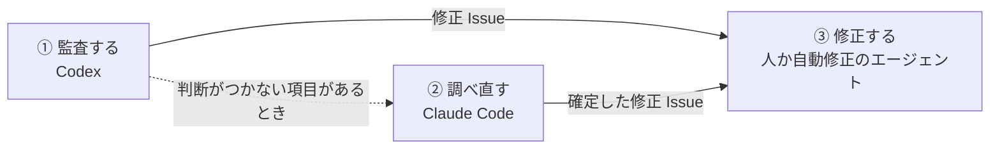

# security-audit-workflow

[Cloudflare の security-audit スキル](https://github.com/cloudflare/security-audit-skill)でプロジェクトをセキュリティ監査し、結果を GitHub の Issue にまとめるためのスキル集。\
判断がつかなかった項目は、あとから別のモデルで調べ直して Issue を更新できる。\
監査は Codex、調べ直しは Claude Code で行う。\
初めて使うときは、[はじめに](#はじめに)から進める。



| 段階 | エージェント | スキル | 結果 |
| --- | --- | --- | --- |
| ① 監査する | Codex | security-audit-sync-issues | 確定所見の修正 Issue と、全判定の集約 Issue ができる |
| ② 調べ直す（必要なとき） | Claude Code | security-audit-verify-items | 判断がつかなかった項目を調べ直し、確定を修正 Issue にして集約 Issue を更新する |
| ③ 修正する | — | — | 人か自動修正のエージェントが、修正 Issue をもとに直す |

監査 1 回ごとに、次の形の Issue ができる（ことばの意味は[用語](#用語)にある）。

```text
集約 Issue  [yyyy-mm-dd] セキュリティ監査の調査・判定一覧  agent:security-audit
│   すべての項目の判定（確定・要検証・未検証・棄却）と、終えられなかった工程・範囲
├─ 修正 Issue（根本原因ごと）  agent:security-audit  agent:autofix
└─ 修正 Issue（根本原因ごと）  agent:security-audit
```

## Codex と Claude Code に分ける理由

- **監査は Codex**: Codex のスケジュールではモデルと推論レベルを指定できるので、決まった設定で監査を定期的に回せる。
- **調べ直しは Claude Code**: Codex で判断がつかなかった項目には、ガードレールで止まって調べられなかったもの（DayBreak を勧められて停止する）も含まれる。\
  こうした項目は Codex で調べ直しても結果が変わりにくいので、別のモデルで補う（実質的にクロス監査になる）。
- **1 項目ずつなら Claude Code は止まりにくい**: Claude Code もガードレールに引っかかると Opus 4.8 に切り替わるが、Codex の監査結果を 1 項目ずつ調べる形では起きにくい。

## 推奨モデル

| エージェント | 推奨 | 利用枠に余裕があるとき |
| --- | --- | --- |
| Codex（監査） | GPT-6.1 Sol（`gpt-6.1-sol`）、推論レベル high | GPT-6 Astra（`gpt-6-astra`）、推論レベル high |
| Claude Code（調べ直し） | Opus 5.5（`claude-opus-5-5`）、推論レベル high | Fable 5.2（`claude-fable-5-2`）、推論レベル high |

モデルは、Codex ではスケジュールの設定（手で呼ぶときはセッション）で、Claude Code では security-audit-verify-items を呼ぶセッションで選ぶ。\
項目を調べる Security Audit Item Verifier は、セッションのモデルによらず、定義で Opus 5.5・推論レベル high に固定されている。

## はじめに

監査だけなら Codex の準備を、調べ直しもするなら Claude Code の準備も行う。

1. **Cloudflare の security-audit スキルを入れる（監査に使う）**: [Skills CLI](https://skills.sh) を `npx` で使い、[Cloudflare の security-audit スキル](https://github.com/cloudflare/security-audit-skill/tree/main/skills/security-audit)の最新版を Codex 用にユーザー全体へ入れる（入る場所は `~/.agents/skills/security-audit/`）。\
   Node.js 22.20 以上が必要。

   ```bash
   npx skills add cloudflare/security-audit-skill --skill security-audit -g -a codex -y
   ```

   あとから最新にするときは、`npx skills update security-audit -g` を実行する。\
   別の信頼できる場所に置いたときは、security-audit-sync-issues を呼ぶときにその場所を伝える。

2. **このリポジトリを clone してリンクする**: clone したフォルダの直下で、リンクのスクリプトを実行する。

   ```bash
   git clone https://github.com/nir-nmttg/security-audit-workflow.git
   ```

   ```bash
   cd security-audit-workflow && scripts/link-skills.sh
   ```

   <details>
   <summary>リンクの補足</summary>

   Claude Code は `~/.claude/skills/`・`~/.claude/agents/`（`CLAUDE_CONFIG_DIR` があればその配下）、Codex は `~/.agents/skills/` にリンクされる。\
   `--claude` / `--codex` を付けると、片方だけリンクできる。\
   既存の同名ファイルや、別の場所への有効なリンクは上書きしない。\
   git worktree からは実行できない。

   </details>

3. **準備ができているかを確かめる**: Codex では `$security-audit-preflight`、Claude Code では `/security-audit-preflight` を呼ぶ（詳しくは[準備と更新のスキル](#準備と更新のスキル)）。\
   主な前提は次のとおり（細かい条件は各 SKILL.md にある）。

   | 前提 | security-audit-sync-issues | security-audit-verify-items |
   | --- | --- | --- |
   | Cloudflare の `security-audit` を入れてある（手順 1） | 必要 | — |
   | Codex でサブエージェントを使える | 必要 | — |
   | Codex のデスクトップアプリ | 定期的に回すときに必要（手元のプロジェクトをスケジュールで動かせるのはアプリだけで、実行の時刻にはパソコンとアプリを起動しておく） | — |
   | `git`・`node` | 必要 | 必要 |
   | `gh` でログイン済み | 必要 | 必要 |
   | Issue を書くリポジトリが非公開で、Issue が有効 | 必要 | 必要 |
   | `jq`・`perl` | — | 必要 |
   | サブエージェントの定義がリンクされている（手順 2） | — | 必要 |
   | Claude Code で Opus 5.5（`claude-opus-5-5`）を使える | — | 必要（Security Audit Item Verifier のモデル） |
   | Claude デスクトップアプリの組み込みブラウザ | — | あるとよい（ないと画面での裏付けができない） |

あとからこのスキル集の更新を取り込むときは、Claude Code から `/security-audit-skills-update` を呼ぶ。\
Claude Code を使わないときは、`git pull` のあと `scripts/link-skills.sh` を実行する。

## 使い方

### ① 監査する（Codex）

監査するプロジェクトの直下で、Codex から呼ぶ。

```text
$security-audit-sync-issues
$security-audit-sync-issues --profile quick
```

- 引数なしなら、時間のかかる `deep` で監査する。\
  `--profile` で `quick`・`standard`・`deep` を選べ、初めて試すときは `quick` で流れを確かめられる（`quick` でも Issue は作られる）。
- 定期的に回すときは、Codex のデスクトップアプリでスケジュールを作り、監査するプロジェクトとこの呼び出しを設定して、モデルと推論レベルを[推奨モデル](#推奨モデル)に合わせる。\
  実行の時刻には、パソコンとアプリを起動しておく。\
  同じリポジトリへの監査は、同時に 1 件だけ動くようにする。
- 終わると、確定所見が修正 Issue に、全判定が集約 Issue になる。\
  自動で直せる修正 Issue には `agent:autofix` が付く。
- 監査の成果物は `~/security-audit-skill/<リポジトリ名>/run-<N>/` に保存される（GitHub に書けなかったときも残る）。

> [!IMPORTANT]
> ガードレールで止まりにくくしてあるが、まれに監査そのものが止まる。\
> 終わるはずの時間を過ぎても Issue ができていなければ、Codex のセッションを確かめ、止まっていれば続きを進めるよう指示する。

### ② 調べ直す（必要なとき、Claude Code）

集約 Issue に要検証・未検証・未完了の工程・範囲の項目が残ったら、同じプロジェクトの直下で、Claude Code から呼ぶ。

```text
/security-audit-verify-items
/security-audit-verify-items A03 U01
/security-audit-verify-items 42 A03
```

- **引数なし**: 開いている最新の集約 Issue の、要検証・未検証・未完了の工程・範囲のすべてを調べる（調べる前に一覧で確かめる）。
- **`A03 U01`**: 最新の集約 Issue の、番号が `A03` と `U01` の項目だけを調べる。
- **`42 A03`**: Issue 番号 `42`（URL でもよい）の集約 Issue の、`A03` の項目だけを調べる。

Security Audit Item Verifier が項目ごとに並列で調べ、途中でコマンドを実行してよいかの確認や、質問をすることがある。\
すべての結果をユーザーと確かめてから、確定を修正 Issue にし、集約 Issue をまとめて更新する（コードは直さない）。\
作業用ファイルは、監査するプロジェクトではなく、このスキル集を clone した場所の `artifacts/security-audit-verify-items/`（gitignore 済み）に置く。

> [!WARNING]
> 監査が未完了の集約 Issue は、security-audit-sync-issues で同じ実行を再開すると監査用の区画が組み直され、調べ直した内容が消えることがある。\
> 同じ実行を再開するつもりなら、再開を済ませてから調べ直す。

### ③ 修正する

修正 Issue をもとに、人か自動修正のエージェントが直す。\
`agent:autofix` の付いた修正 Issue は、自動修正のエージェントに拾わせられる。

## スキル一覧

どれも、Codex 用は `$スキル名`、Claude Code 用は `/スキル名` で呼んだときだけ動く。\
準備と更新のスキルは、[準備と更新のスキル](#準備と更新のスキル)にある。

| スキル | エージェント | できること |
| --- | --- | --- |
| security-audit-sync-issues | [Codex](.agents/skills/security-audit-sync-issues/SKILL.md) | プロジェクトを自律監査し、確定所見の修正 Issue と全判定の集約 Issue を作成・更新する |
| security-audit-verify-items | [Claude Code](.claude/skills/security-audit-verify-items/SKILL.md) | 集約 Issue の判断がつかなかった項目を Security Audit Item Verifier に並列で調べさせ、ユーザーと確かめてから、確定を修正 Issue にして集約 Issue を更新する |

## 準備と更新のスキル

監査と調べ直しのほかに、準備ができているかを確かめるスキルと、このスキル集を更新するスキルがある。\
Codex 用は `$スキル名`、Claude Code 用は `/スキル名` で呼ぶ。

| スキル | エージェント | 使うとき | すること |
| --- | --- | --- | --- |
| security-audit-preflight | [Claude Code](.claude/skills/security-audit-preflight/SKILL.md)・[Codex](.agents/skills/security-audit-preflight/SKILL.md) | 初めて使うとき、環境を変えたとき | 必要なコマンド・ログイン・リンクがそろっているかを確かめる |
| security-audit-skills-update | [Claude Code](.claude/skills/security-audit-skills-update/SKILL.md) | このスキル集の更新を取り込みたいとき | このスキル集を最新にしてリンクし直し、security-audit-preflight の確認結果を表示する |

**security-audit-preflight**

- Claude Code 用は、足りないコマンドとリンクを、了承を得てから入れる（macOS と Homebrew が前提）。
- Codex 用は確かめるだけで、Cloudflare の `security-audit` と、Issue を書くリポジトリの状態も見る。

**security-audit-skills-update**

- clone した元のフォルダ（メインの checkout）が既定ブランチ（通常は `main`）にあるときだけ、origin から fast-forward で取り込み、Claude Code と Codex の両方にリンクし直す。
- 未コミットの変更と衝突するときや、履歴が分かれているときは、作業ツリーを変えずに取り込みを飛ばす。
- git worktree から呼んでも、clone した元のフォルダで実行する。
- 確認結果に足りないものがあっても、ここでは入れない（security-audit-preflight で入れる）。
- Cloudflare の `security-audit` は更新しない（[はじめに](#はじめに)の手順 1 のとおりに更新する）。

## 用語

| 用語 | 意味 |
| --- | --- |
| 集約 Issue | 監査 1 回ごとに作る Issue で、すべての項目の判定と、終えられなかった工程・範囲を一覧にする |
| 修正 Issue | 確定所見を根本原因ごとにまとめた Issue で、集約 Issue のサブ Issue になる |
| 確定 | 問題があると判断できた所見（修正 Issue になる） |
| 要検証 | 確定か棄却かを決めるのに、仕様の確認、ローカルでの検証、環境・権限の確認などが必要な所見 |
| 未検証 | 調査が途中で止まった候補 |
| 棄却 | 問題ではないと判断した疑い |
| 未完了の工程・範囲 | 監査や Issue への反映を終えられなかった工程・範囲 |
| 番号 | 集約 Issue の一覧表の No.（`A03`・`U01` など）で、調べ直す項目を指すのに使う |
| ガードレール | モデルの安全のための仕組みで、引っかかると Codex は DayBreak を勧めて止まり、Claude Code は Opus 4.8 に切り替わる |
| Security Audit Item Verifier | security-audit-verify-items が項目ごとに起動して調べさせる、Opus 5.5 のサブエージェント |
| `agent:security-audit` | このスキル集で作った集約 Issue と修正 Issue のすべてに付くラベル |
| `agent:autofix` | 質問せずに直せると判断した修正 Issue に付くラベルで、自動修正のエージェントに拾わせる目印になる |

## つまずきやすい点

- **スキルが候補に出ない**: このスキル集の直下で `scripts/link-skills.sh` を実行し直し、新しいセッションを始めるか Codex を再起動する。
- **リンクのスクリプトが「git worktree の中なのでリンクしません」と止まる**: clone した元のフォルダ（メインの checkout）で実行する。
- **リンクのスクリプトが `skip` と表示する**: 同名のファイルや別の場所へのリンクがあるので、不要なら自分で移してから実行し直す。
- **Issue が作られない**: まず Codex のセッションを確かめ、ガードレールで止まっていれば続きを進めるよう指示する。\
  止まっていなければ、Issue を書くリポジトリが非公開で、Issue が有効かを確かめる。\
  GitHub に書けなくても、監査の成果物は端末に残る。
- **調べ直した内容が集約 Issue から消えた**: 調べ直したあとに、security-audit-sync-issues で未完了の同じ実行を再開したため。\
  再開するつもりなら、再開を済ませてから調べ直す。

## スキルの追加・変更

作り方と変更時の確認は [AGENTS.md](AGENTS.md) にある。

## ライセンス

[MIT License](LICENSE)
