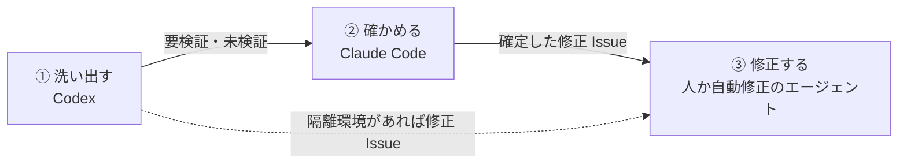

# security-audit-workflow

[Cloudflare の security-audit スキル](https://github.com/cloudflare/security-audit-skill)でプロジェクトをセキュリティ監査し、結果を GitHub の Issue にまとめるためのスキル集。\
Codex が広く洗い出し、Claude Code が要検証の項目を手元の材料と人の知識で確かめて、確定を修正 Issue にする。\
Cloudflare の security-audit は、隔離した実行環境がないと所見を確定にしないので、ふつうの環境では ② が毎回の 2 段目になる。\
初めて使うときは、[はじめに](#はじめに)から進める。



| 段階 | エージェント | スキル | 結果 |
| --- | --- | --- | --- |
| ① 洗い出す | Codex | security-audit-sync-issues | 全判定の集約 Issue ができる（隔離環境があれば確定所見の修正 Issue もできる） |
| ② 確かめる | Claude Code | security-audit-verify-items | 要検証などの項目を確かめ、確定を修正 Issue にして集約 Issue を更新する |
| ③ 修正する | — | — | 人か自動修正のエージェントが、修正 Issue をもとに直す |

監査ごとに、次の形の Issue ができる（続きの監査では同じ集約 Issue を更新する。ことばの意味は[用語](#用語)にある）。

```text
集約 Issue  [yyyy-mm-dd] セキュリティ監査の調査・判定一覧  agent:security-audit
│   すべての項目の判定（確定・要検証・未検証・棄却）と、終えられなかった工程・範囲
├─ 修正 Issue（根本原因ごと）  agent:security-audit  agent:autofix
└─ 修正 Issue（根本原因ごと）  agent:security-audit
```

## Codex と Claude Code に分ける理由

- **監査は Codex**: Codex のスケジュールではモデルと推論レベルを指定できるので、決まった設定で監査を定期的に回せる。
- **調べ直しは Claude Code**: Codex で判断がつかなかった項目には、ガードレールで止まって調べられなかったもの（DayBreak を勧められて停止する）も含まれる。\
  Codex の監査でも、監査を分担するサブエージェントがガードレールで止まった作業は、GPT-6.1 Terra に 1 回だけ頼み直す（モデルで止まり方が変わるかを確かめるための試み）。\
  それでも止まった項目は Codex で調べ直しても結果が変わりにくいので、別のモデルで補う（実質的にクロス監査になる）。
- **1 項目ずつなら Claude Code は止まりにくい**: Claude Code もガードレールに引っかかると Opus 4.8 に切り替わるが、Codex の監査結果を 1 項目ずつ調べる形では起きにくい。
- **確定にするのは Claude Code**: Codex の監査は、隔離環境がないと要検証に留める。\
  Claude Code は、関連するリポジトリ・使い捨てのコンテナでの実行・人の知識を材料に、項目ごとに確定か棄却かを決める。

## 推奨モデル

| エージェント | 推奨 | 利用枠に余裕があるとき |
| --- | --- | --- |
| Codex（監査） | GPT-6.2 Sol（`gpt-6.2-sol`）、推論レベル high | GPT-6.2 Astra（`gpt-6.2-astra`）、推論レベル high |
| Claude Code（調べ直し） | Opus 5.5（`claude-opus-5-5`）、推論レベル high | Fable 5.2（`claude-fable-5-2`）、推論レベル high |

モデルは、Codex ではスケジュールの設定（手で呼ぶときはセッション）で、Claude Code では security-audit-verify-items を呼ぶセッションで選ぶ。\
Codex の監査で、監査を分担するサブエージェントがガードレールに止められた作業は、GPT-6.1 Terra（`gpt-6.1-terra`）の新しいサブエージェントに 1 回だけ頼み直す（推論レベルはセッションと同じ）。\
項目を調べる Security Audit Item Verifier は、セッションのモデルによらず、定義で Opus 5.5 に固定されている。\
推論レベルは、security-audit-verify-items を呼んだ時点のセッションの推論レベルに合わせる（わからないときは high）。

## はじめに

監査だけなら Codex の準備を、調べ直しもするなら Claude Code の準備も行う。

1. **Cloudflare の security-audit スキルを入れる（監査に使う）**: [Skills CLI](https://skills.sh) を `npx` で使い、[Cloudflare の security-audit スキル](https://github.com/cloudflare/security-audit-skill/tree/main/skills/security-audit)の最新版を Codex 用にユーザー全体へ入れる（入る場所は `~/.agents/skills/security-audit/`）。\
   Node.js 22.20 以上が必要。

   ```bash
   npx skills add cloudflare/security-audit-skill --skill security-audit -g -a codex -y
   ```

   あとから最新にするときは、`npx skills update security-audit -g` を実行する。\
   別の信頼できる場所に置いたときは、security-audit-sync-issues を呼ぶときにその場所を伝える。

2. **このリポジトリを clone してリンクする**: clone したフォルダの直下で、リンクのスクリプトを実行する。

   ```bash
   git clone https://github.com/nir-nmttg/security-audit-workflow.git
   ```

   ```bash
   cd security-audit-workflow && scripts/link-skills.sh
   ```

   <details>
   <summary>リンクの補足</summary>

   Claude Code は `~/.claude/skills/`・`~/.claude/agents/`（`CLAUDE_CONFIG_DIR` があればその配下）、Codex は `~/.agents/skills/` にリンクされる。\
   `--claude` / `--codex` を付けると、片方だけリンクできる。\
   既存の同名ファイルや、別の場所への有効なリンクは上書きしない。\
   git worktree からは実行できない。

   </details>

3. **準備ができているかを確かめる**: Codex では `$security-audit-preflight`、Claude Code では `/security-audit-preflight` を呼ぶ（詳しくは[準備と更新のスキル](#準備と更新のスキル)）。\
   主な前提は次のとおり（細かい条件は各 SKILL.md にある）。

   | 前提 | security-audit-sync-issues | security-audit-verify-items |
   | --- | --- | --- |
   | Cloudflare の `security-audit` を入れてある（手順 1） | 必要 | — |
   | Codex でサブエージェントを使える | 必要 | — |
   | Codex で GPT-6.1 Terra（`gpt-6.1-terra`）を使える | あるとよい（ないとガードレールで止まった作業を頼み直さない） | — |
   | Codex のデスクトップアプリ | 定期的に回すときに必要（手元のプロジェクトをスケジュールで動かせるのはアプリだけで、実行の時刻にはパソコンとアプリを起動しておく） | — |
   | `git`・`node` | 必要 | 必要 |
   | `gh` でログイン済み | 必要 | 必要 |
   | Issue を書くリポジトリが非公開で、Issue が有効 | 必要 | 必要 |
   | `jq`・`perl` | — | 必要 |
   | サブエージェントの定義がリンクされている（手順 2） | — | 必要 |
   | Claude Code で Opus 5.5（`claude-opus-5-5`）を使える | — | 必要（Security Audit Item Verifier のモデル） |
   | Claude デスクトップアプリの組み込みブラウザ | — | あるとよい（ないと画面での裏付けができない） |

あとからこのスキル集の更新を取り込むときは、Claude Code から `/security-audit-skills-update` を呼ぶ。\
Claude Code を使わないときは、`git pull` のあと `scripts/link-skills.sh` を実行する。

## 使い方

### ① 監査する（Codex）

監査するプロジェクトの直下で、Codex から呼ぶ。

```text
$security-audit-sync-issues
$security-audit-sync-issues --profile quick
$security-audit-sync-issues https://github.com/<owner>/<repo>/issues/42
```

- 引数なしなら、時間のかかる `deep` で監査する。\
  `--profile` で `quick`・`standard`・`deep` を選べ、初めて試すときは `quick` で流れを確かめられる（`quick` でも Issue は作られる）。
- 定期的に回すときは、Codex のデスクトップアプリでスケジュールを作り、監査するプロジェクトとこの呼び出しを設定して、モデルと推論レベルを[推奨モデル](#推奨モデル)に合わせる。\
  実行の時刻には、パソコンとアプリを起動しておく。\
  同じリポジトリへの監査は、同時に 1 件だけ動くようにする。
- 集約 Issue の URL（か番号）を渡すと **続きの監査** になり、新しい集約 Issue を作らずに、その Issue の未検証と未完了の工程・範囲を調べ直して差し替える。\
  調べ直した内容や人の追記は消えない。
- 終わると、全判定が集約 Issue になり、確定所見があれば修正 Issue になる。\
  自動で直せる修正 Issue には `agent:autofix` が付く。\
  最後の報告に、次の一手（続きの監査の呼び方や、② で確かめる項目）が書かれる。
- 監査の成果物は `~/security-audit-skill/<リポジトリ名>/run-<N>/` に保存される（GitHub に書けなかったときも残る）。

> [!IMPORTANT]
> ガードレールで止まりにくくしてあるが、まれに監査そのものが止まる。\
> 終わるはずの時間を過ぎても Issue ができていなければ、Codex のセッションを確かめ、止まっていれば続きを進めるよう指示する。\
> 監査を終えたあとで保留が残ったときは、報告の次の一手のとおり、集約 Issue を渡して続きの監査を呼ぶ。

### ② 確かめる（Claude Code）

集約 Issue に要検証・未検証・未完了の工程・範囲の項目が残ったら、同じプロジェクトの直下で、Claude Code から呼ぶ。

```text
/security-audit-verify-items
/security-audit-verify-items A03 U01
/security-audit-verify-items 42 A03
```

- **引数なし**: 開いている最新の集約 Issue の、要検証・未検証・未完了の工程・範囲のすべてを調べる（調べる前に一覧で確かめる）。
- **`A03 U01`**: 最新の集約 Issue の、番号が `A03` と `U01` の項目だけを調べる。
- **`42 A03`**: Issue 番号 `42`（URL でもよい）の集約 Issue の、`A03` の項目だけを調べる。

Security Audit Item Verifier が項目ごとに並列で調べ、途中でコマンドを実行してよいかを確認することがある。\
手元にある関連リポジトリ（共有ライブラリ・インフラなど）は、対象が採用している版を写して材料にする。\
質問は全項目が終わってからまとめて 1 回だけ聞き、そのあと書き込む内容を 1 回で確かめる。\
了承を得てから、確定を修正 Issue にし、集約 Issue をまとめて更新する（コードは直さない）。\
GitHub への書き込みは事前に許可していないスクリプトで行うので、書き込みのたびに権限モードの確認が入る。\
作業用ファイルは、監査するプロジェクトではなく、このスキル集を clone した場所の `artifacts/security-audit-verify-items/`（gitignore 済み）に置く。\
項目を分けて、別々のセッションで同時に呼んでもよい（集約 Issue への書き込みは 1 つずつ順番に行う）。\
ただし、根本原因が重なる項目は同じセッションにまとめる（修正 Issue の重複の確認から作成までは、セッションどうしで順番を取らない）。

> [!WARNING]
> 監査が未完了の集約 Issue は、security-audit-sync-issues で同じ実行を再開すると監査用の区画が組み直され、調べ直した内容が消えることがある。\
> 同じ実行を再開するつもりなら、再開を済ませてから調べ直す（集約 Issue を渡す続きの監査なら消えない）。

### ③ 修正する

修正 Issue をもとに、人か自動修正のエージェントが直す。\
`agent:autofix` の付いた修正 Issue は、自動修正のエージェントに拾わせられる。

## スキル一覧

どれも、Codex 用は `$スキル名`、Claude Code 用は `/スキル名` で呼んだときだけ動く。\
準備と更新のスキルは、[準備と更新のスキル](#準備と更新のスキル)にある。

| スキル | エージェント | できること |
| --- | --- | --- |
| security-audit-sync-issues | [Codex](.agents/skills/security-audit-sync-issues/SKILL.md) | プロジェクトを自律監査して全判定の集約 Issue を作成・更新し、確定所見があれば修正 Issue にする |
| security-audit-verify-items | [Claude Code](.claude/skills/security-audit-verify-items/SKILL.md) | 集約 Issue の要検証などの項目を Security Audit Item Verifier に並列で確かめさせ、ユーザーと確かめてから、確定を修正 Issue にして集約 Issue を更新する |

## 準備と更新のスキル

監査と調べ直しのほかに、準備ができているかを確かめるスキルと、このスキル集を更新するスキルがある。\
Codex 用は `$スキル名`、Claude Code 用は `/スキル名` で呼ぶ。

| スキル | エージェント | 使うとき | すること |
| --- | --- | --- | --- |
| security-audit-preflight | [Claude Code](.claude/skills/security-audit-preflight/SKILL.md)・[Codex](.agents/skills/security-audit-preflight/SKILL.md) | 初めて使うとき、環境を変えたとき | 必要なコマンド・ログイン・リンクがそろっているかを確かめる |
| security-audit-skills-update | [Claude Code](.claude/skills/security-audit-skills-update/SKILL.md) | このスキル集の更新を取り込みたいとき | このスキル集を最新にしてリンクし直し、security-audit-preflight の確認結果を表示する |

**security-audit-preflight**

- すべてそろっていれば、1 行で知らせる。
- Claude Code 用は、足りないコマンドとリンクを、了承を得てから入れる（macOS と Homebrew が前提）。
- Codex 用は確かめるだけで、Cloudflare の `security-audit`、Issue を書くリポジトリの状態、確定に要る隔離環境があるかも見る。

**security-audit-skills-update**

- clone した元のフォルダ（メインの checkout）が既定ブランチ（通常は `main`）にあるときだけ、origin から fast-forward で取り込み、Claude Code と Codex の両方にリンクし直す。
- 未コミットの変更と衝突するときや、履歴が分かれているときは、作業ツリーを変えずに取り込みを飛ばす。
- git worktree から呼んでも、clone した元のフォルダで実行する。
- 変わったものがなければ、成否の行だけを短く表示する（失敗は必ず表示する）。
- 確認結果に足りないものがあっても、ここでは入れない（security-audit-preflight で入れる）。
- Cloudflare の `security-audit` は更新しない（[はじめに](#はじめに)の手順 1 のとおりに更新する）。

## 用語

| 用語 | 意味 |
| --- | --- |
| 集約 Issue | 監査ごとに作る Issue で、すべての項目の判定と、終えられなかった工程・範囲を一覧にする（続きの監査では既存のものを更新する） |
| 続きの監査 | security-audit-sync-issues に集約 Issue を渡して、その Issue の項目を調べ直して差し替える使い方 |
| 修正 Issue | 確定所見を根本原因ごとにまとめた Issue で、集約 Issue のサブ Issue になる |
| 確定 | 問題があると判断できた所見（修正 Issue になる） |
| 要検証 | 確定か棄却かを決めるのに、仕様の確認、ローカルでの検証、環境・権限の確認などが必要な所見 |
| 未検証 | 調査が途中で止まった候補 |
| 棄却 | 問題ではないと判断した疑い |
| 未完了の工程・範囲 | 監査や Issue への反映を終えられなかった工程・範囲 |
| 番号 | 集約 Issue の一覧表の No.（`A03`・`U01` など）で、調べ直す項目を指すのに使う |
| 隔離環境 | 外部ネットワークを禁じるなど、OS で強制した実行環境。Cloudflare の security-audit は、これがないと所見を確定にしない |
| 関連リポジトリ | 監査するプロジェクトが使う共有ライブラリやインフラなどのリポジトリで、security-audit-verify-items が版を固定して写し、材料にする |
| ガードレール | モデルの安全のための仕組みで、引っかかると Codex は DayBreak を勧めて止まり、Claude Code は Opus 4.8 に切り替わる |
| Security Audit Item Verifier | security-audit-verify-items が項目ごとに起動して調べさせる、Opus 5.5 のサブエージェント |
| `agent:security-audit` | このスキル集で作った集約 Issue と修正 Issue のすべてに付くラベル（なければ決まった色と説明で作る） |
| `agent:autofix` | 質問せずに直せると判断した修正 Issue に付くラベルで、自動修正のエージェントに拾わせる目印になる（なければ決まった色と説明で作る） |

## つまずきやすい点

- **スキルが候補に出ない**: このスキル集の直下で `scripts/link-skills.sh` を実行し直し、新しいセッションを始めるか Codex を再起動する。
- **リンクのスクリプトが「git worktree の中なのでリンクしません」と止まる**: clone した元のフォルダ（メインの checkout）で実行する。
- **リンクのスクリプトが `skip` と表示する**: 同名のファイルや別の場所へのリンクがあるので、不要なら自分で移してから実行し直す。
- **Issue が作られない**: まず Codex のセッションを確かめ、ガードレールで止まっていれば続きを進めるよう指示する。\
  止まっていなければ、Issue を書くリポジトリが非公開で、Issue が有効かを確かめる。\
  GitHub に書けなくても、監査の成果物は端末に残る。
- **集約 Issue の「Terra での頼み直し」が `unavailable` と `skipped_unavailable` ばかりになっている**: Codex で GPT-6.1 Terra を使えないと、最初の 1 件で使えないことを記録し、そのあとは頼み直さずに保留にする。\
  Codex のモデルの一覧に GPT-6.1 Terra があるかを確かめる。
- **集約 Issue の本文に詳細がなく、「詳細:」のリンクだけがある**: 本文が GitHub の上限を超えたので、区分ごとの詳細を集約 Issue のコメントに移した。\
  詳細を直すときは、リンク先のコメントの該当する項目を書き換える。
- **調べ直した内容が集約 Issue から消えた**: 調べ直したあとに、security-audit-sync-issues で未完了の同じ実行を再開したため。\
  再開するつもりなら、再開を済ませてから調べ直すか、集約 Issue を渡して続きの監査にする。
- **Codex の監査で確定が 0 件になる**: 隔離環境がない環境では、Cloudflare の security-audit が所見を要検証に留めるため（ふつうの結果）。\
  要検証の項目は security-audit-verify-items で確かめる。
- **security-audit-verify-items が `skills_behind` と表示する**: このスキル集が origin より古い版で動いている。\
  `/security-audit-skills-update` で更新してから使う。
- **security-audit-verify-items が集約 Issue の書式の異常で止まる**: 手で書き換えたなどで、集約 Issue が書式どおりでない。\
  表示された理由の語を見て書式に直すか、組み直しを別に頼む。

## スキルの追加・変更

Issue と Pull Request は誰でも歓迎する（出し方は [CONTRIBUTING.md](CONTRIBUTING.md) にある）。\
作り方と変更時の確認は [AGENTS.md](AGENTS.md) にある。\
脆弱性は公開の Issue に書かず、[SECURITY.md](SECURITY.md) の方法で報告する。

## ライセンス

[MIT License](LICENSE)
